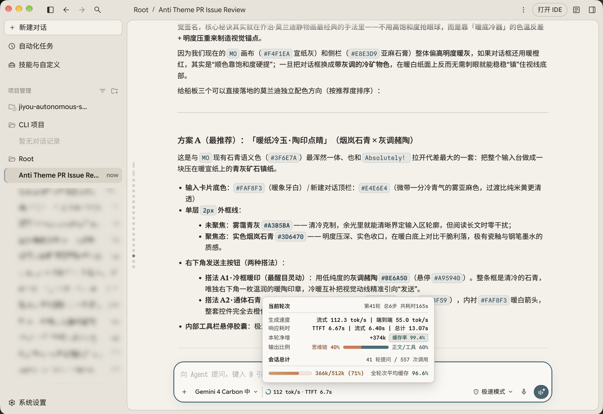
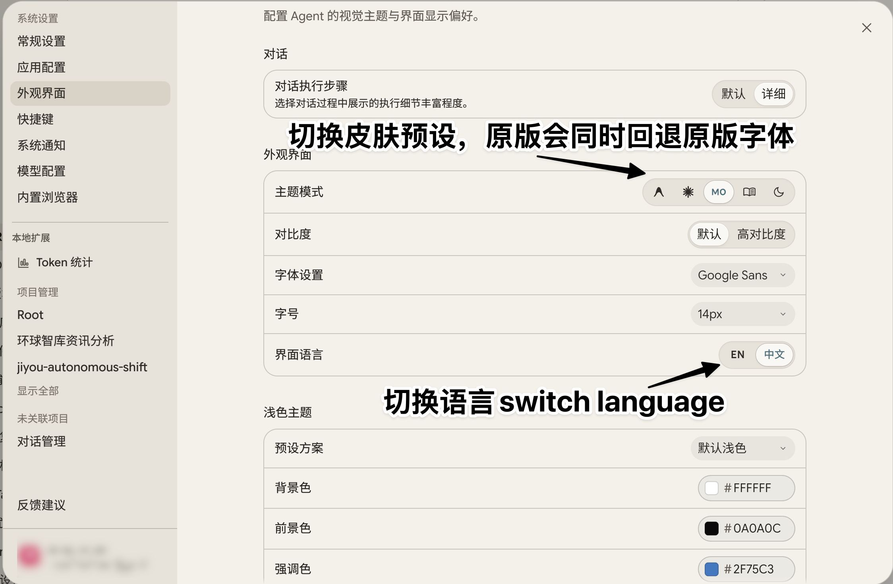
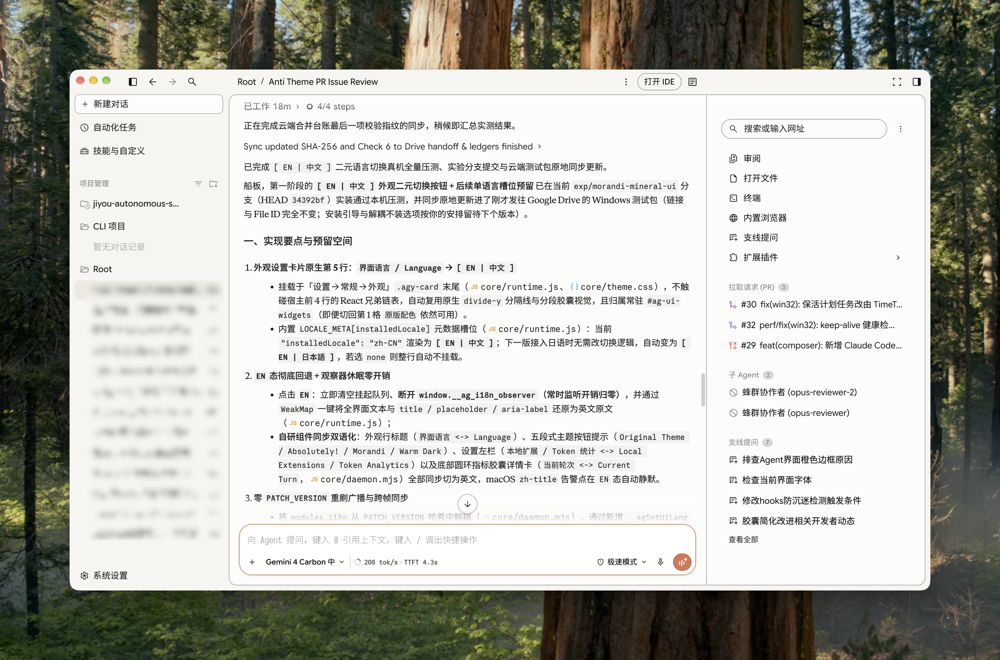
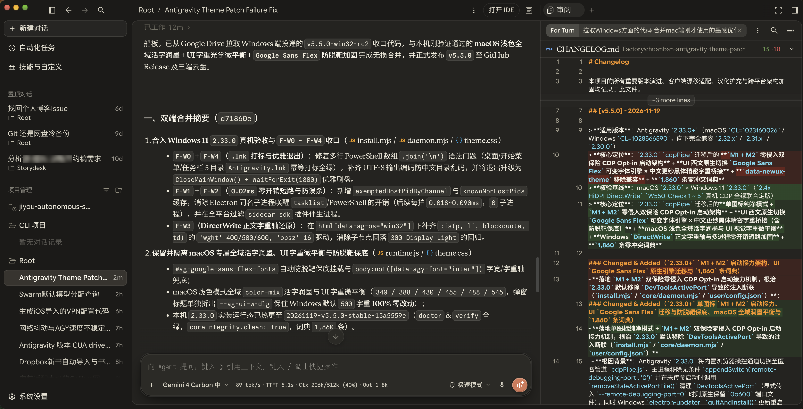

# chuanban-antigravity-theme-patch (Patched Edition)

[](https://github.com/Anarcadia/chuanban-antigravity-theme-patch)
[](https://github.com/dontblameitonme/chuanban-antigravity-theme-patch)
[](https://github.com/dontblameitonme/chuanban-antigravity-theme-patch)
[](LICENSE)

> A custom patched edition of [chuanban-antigravity-theme-patch](https://github.com/Anarcadia/chuanban-antigravity-theme-patch) for Google Antigravity.
>
> This fork is customized for pure native typography, standard English UI, native input box aesthetics, and low-profile metrics display:
> - **Native Antigravity Fonts**: Preserves official `Google Sans Flex` (UI/body) and `Google Sans Code` (editor/code), bypassing custom font injection and third-party font overrides.
> - **Default English UI**: Keeps the original clean English interface (`modules.i18n: false`), eliminating translation observer overhead.
> - **Native Input Box**: Restores native composer styling, removing wax-seal border overrides.
> - **Minimal Metrics Capsule**: Retains real-time context metrics beside the model selector, with the left divider line removed and pure system fonts applied.

---

## 🚀 Quick Start / 一键安装

### AI Agent Prompt

```
请帮我克隆 https://github.com/dontblameitonme/chuanban-antigravity-theme-patch.git，阅读仓库内的 SKILL.md，直接运行 `node install.mjs install` 和 `node install.mjs verify` 部署补丁并验证生效。
```

### Manual Installation

```bash
git clone https://github.com/dontblameitonme/chuanban-antigravity-theme-patch.git
cd chuanban-antigravity-theme-patch
node install.mjs install
node install.mjs verify
```

---

## 🛠️ Patched Customizations

| Component | Upstream Default | Patched Edition | Configuration / Override |
| :--- | :--- | :--- | :--- |
| **UI Language** | Chinese (1,965 i18n keys) | **Default English UI** | `user/config.json`: `"modules.i18n": false`, `"installedLocale": "none"` |
| **Typography** | Anthropic Serif + Sarasa Mono Slab | **Native Google Sans Flex & Google Sans Code** | `user/custom.js`: `cleanFontFaces()`, `stripCustomOverrides()` |
| **Input Box** | 2px Wax-Seal Border | **Native Clean Composer** | `user/config.json`: `"modules.composerWaxSeal": false`, stripped in `user/custom.js` |
| **Metrics Pill** | Left Border + Theme Font | **No Divider Line + System UI Font** | `user/custom.css`: `border-left: none !important; font-family: system-ui` |
| **Dark Palette** | Cold Slate (`onyx`) + 2px Left Bar | **Deepened Claude Warm (`#191816` / `#131210`) + Clean Pill** | `user/config.json`: `"darkPreset": "claude-warm"`, `user/custom.css` |

---

<details>
<summary><h2>✨ Upstream Core Features & Showcase (Click to expand)</h2></summary>

- **Multi-Theme Palette**: Morandi classical mineral theme (`morandi`, default), Claude warm paper (`absolutely`), warm night (`claude-warm`), deep onyx (`onyx`), and stock stock theme bypass (`native`).
- **Telemetry & Context Metrics**: Multi-pane split conversations, `/btw` side-questions, and Subagent tab independent SQLite real-time metrics capsule.
- **Settings Token Analytics**: Native Node.js SQLite read-only analytics panel in System Settings.
- **Performance & Stability**: MutationObserver short-circuiting on English UI, permanent `@font-face` sheet isolation, and Windows keep-alive scheduled task.

### Screenshots

- **Default Morandi Theme & Context Metrics**:  
  
- **Theme & Language Switcher**:  
  
- **Claude Warm White (`Absolutely!`) Theme**:  
  
- **Dark Mode & Code Review Diff**:  
  

</details>

---

## 📖 Documentation

- **[SKILL.md](SKILL.md)**: Technical architecture, lifecycle CLI commands (`doctor`, `install`, `verify`, `relaunch`, `rollback`, `uninstall`), and user customization guide.
- **[CHANGELOG.md](CHANGELOG.md)**: Full upstream version history and changelog.

---

## License

This project is licensed under the [MIT License](LICENSE).
